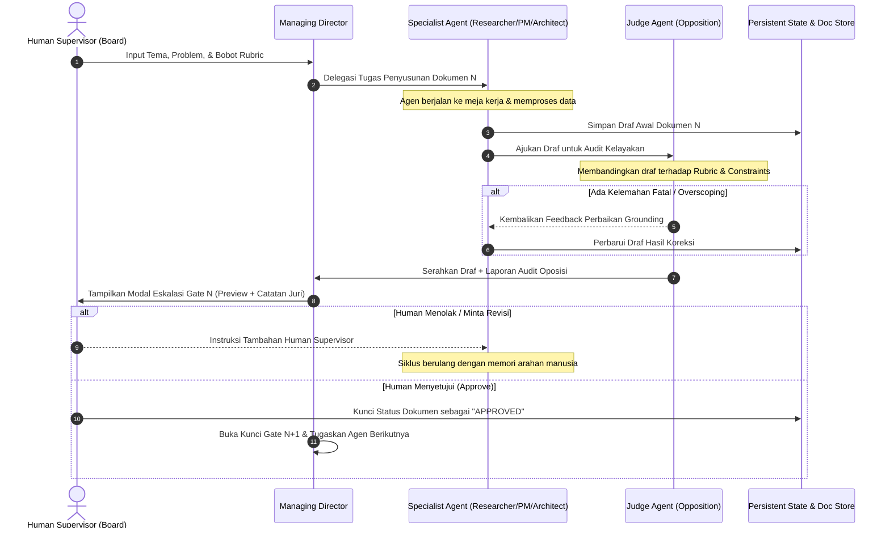

# Dokumen 3b — Alur End-to-End & Jalur Produk (End-to-End Workflows & Tracks): SilaCorp

**Nama Produk:** SilaCorp (The Autonomous Virtual Office Hackathon Agency)  
**Parent Entity:** SilaLabs  
**Versi Dokumen:** 1.0.0  
**Tanggal:** 12 Oktober 2026  
**Status Gate:** Siap Direview Tim & Engineering Lead  

---

## 1. Topologi Jalur Produk (Product Tracks Topology)

Untuk memastikan sistem tidak terbangun secara terfragmentasi, SilaCorp membagi seluruh operasinya ke dalam tiga jalur terintegrasi:

```
┌────────────────────────────────────────────────────────────────────────┐
│                   TRACK 1: JALUR OPERASIONAL UTAMA                     │
│                           (THE GOLDEN PATH)                            │
│  [Intake] ──> [Research] ──> [Concept] ──> [PRD] ──> [Tech/Task] ──>   │
│               [Code Scaffold] ──> [Submission Kit Ready]               │
└───────────────────────────────────┬────────────────────────────────────┘
                                    │ Koordinasi State & Event
┌───────────────────────────────────▼────────────────────────────────────┐
│              TRACK 2: JALUR BACKGROUND & INGESTION PIPELINE            │
│                     (THE FLOOR MANAGEMENT TRACK)                       │
│  • Canvas Spatial Event Stream (Koordinat & Animasi Agen)             │
│  • Memory Context Compressor (Ringkasan State antar-dokumen)          │
│  • Persistent Local & Database Storage Sync                           │
└───────────────────────────────────┬────────────────────────────────────┘
                                    │ Validasi Kontinu
┌───────────────────────────────────▼────────────────────────────────────┐
│               TRACK 3: JALUR EVALUASI & OPOSISI                        │
│                 (THE OPPOSITION & BENCHMARK TRACK)                     │
│  • Hackathon Rubric Compliance Engine                                  │
│  • Devil's Advocate Reality Check & Constraint Auditor                │
│  • Traceability & Anti-Hallucination Gatekeeper                       │
└────────────────────────────────────────────────────────────────────────┘
```

---

## 2. Struktur Hierarki Rute Semantik (URL Routing Map)

Aplikasi SilaCorp menggunakan arsitektur URL yang mencerminkan siklus hidup inovasi secara transparan:

| Rute URL | Tampilan / Komponen Utama | Peran dalam Siklus Hidup |
| :--- | :--- | :--- |
| `/` | `DashboardHome` | Daftar sesi inovasi aktif, arsip sprint sebelumnya, dan tombol inisiasi baru. |
| `/sprint/new` | `IntakeConfigurator` | Konfigurasi tema, panduan juri, bobot rubric, dan pembentukan tim agen. |
| `/sprint/:id` | `VirtualOfficeWorkspace` | **Halaman Utama Operasional:** Kanvas kantor 2D, meja agen, dan bar progres PDCA. |
| `/sprint/:id/docs/:docId` | `ArtifactFocusViewer` | Mode pembaca dokumen mendalam dengan perbandingan draf vs revisi. |
| `/sprint/:id/audit` | `JudgeAuditConsole` | Log lengkap hasil kritik Judge Agent, skor rubric per gate, dan riwayat eskalasi. |
| `/sprint/:id/export` | `SubmissionPackPortal` | Portal pengunduhan dokumen siap kirim, repositori kode, dan slide deck. |

---

## 3. Alur Tertutup (Closed-Loop Sequence)

Setiap tahapan dokumen dan eksekusi mengikuti siklus tertutup 8 langkah tanpa celah gantung:



---

## 4. Strategi Penanganan Latensi, Caching, & Mekanisme Fallback

### 1. Penanganan Latensi & Persepsi Responsivitas (Perceived Latency)
* **Server-Sent Events (SSE) Streaming:** Begitu agen mulai menyusun teks dokumen, stream token langsung disalurkan ke *LiveThoughtFeed* di antarmuka. Pengguna melihat agen "sedang mengetik dan berpikir" secara real-time, menghilangkan persepsi aplikasi macet.
* **Spatial Optimistic Animation:** Sprite agen di kanvas kantor langsung bergerak ke meja tujuan segera setelah event delegasi dikeluarkan, tanpa harus menunggu respons lengkap dari API model AI.

### 2. Strategi Pre-seeding & Memory Context Compression
* **Hierarchical Context Summarizer:** Agar token prompt tidak membengkak dan memicu latensi tinggi pada Dokumen 4 dan 5, sistem otomatis membuat ringkasan sari keputusan (*Executive Digest*) dari Dokumen 1, 2, dan 3 yang telah disahkan. Dokumen mentah tidak di-load seluruhnya ke prompt, melainkan di-reference secara selektif.
* **Pre-seeded Hackathon Rubric Templates:** Sistem menyediakan template rubric baku (misal: format standar AngelHack, Devpost, atau Lomba Inovasi Nasional) yang langsung terisi otomatis jika pengguna memilih preset lomba.

### 3. Mekanisme Fallback Otomatis saat Layanan Terganggu
* **Model Failover Chain:** Jika API penyedia model utama mengalami *rate-limit* (HTTP 429) atau *internal error* (HTTP 500), backend otomatis mengalihkan tugas ke model fallback cadangan dengan parameter temperatur yang disesuaikan dalam waktu <3 detik.
* **Local Offline Snapshot (Zero Data Loss):** Setiap perubahan draf dokumen dan status pergerakan agen secara otomatis disimpan ke `IndexedDB / LocalStorage` browser pengguna setiap 5 detik. Jika tab tertutup atau listrik padam, sesi dapat dipulihkan persis di titik terakhir tanpa mengulang dari awal.

---

## 5. Gate Status: Dokumen 3b — Alur End-to-End & Jalur Produk

> **Gate Criteria:** Seluruh alur perjalanan pengguna utama (golden path) terhubung dari awal hingga akhir tanpa ada fitur yang menggantung atau terputus.  
>  
> **Verifikasi Jalur & Alur:**  
> [x] Topologi 3 Jalur (Golden Path, Floor Pipeline, Opposition Track) saling melengkapi.  
> [x] Routing map mencakup seluruh fase interaksi pengguna dari inisiasi hingga submission pack.  
> [x] Closed-loop sequence memastikan tidak ada dokumen yang lolos tanpa audit juri dan persetujuan manusia.  
> [x] Strategi streaming SSE, kompresi konteks, dan failover model menjamin sistem tahan banting saat sprint berkecepatan tinggi.  
>  
> **Status Gate: PASSED / SIAP LANJUT KE DOKUMEN 4 (Technical Design).**
