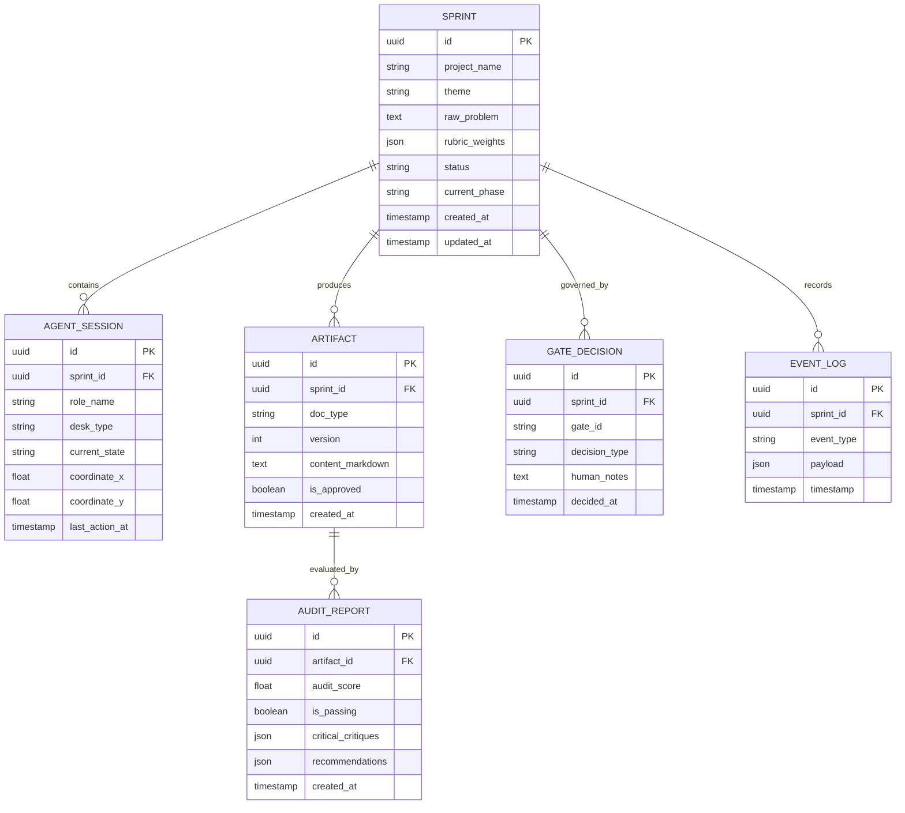

# Dokumen 4 — Technical Design: SilaCorp

**Nama Produk:** SilaCorp (The Autonomous Virtual Office Hackathon Agency)  
**Parent Entity:** SilaLabs  
**Versi Dokumen:** 1.0.0  
**Tanggal:** 12 Oktober 2026  
**Status Gate:** Siap Direview Tim Engineering & Arsitek Sistem  

---

## 1. Arsitektur Sistem & Tanggung Jawab Modul

SilaCorp dibangun dengan arsitektur berbasis modular event-driven:

```
┌────────────────────────────────────────────────────────────────────────┐
│                         FRONTEND (CLIENT TIER)                         │
│  ┌───────────────────────┐ ┌────────────────────────────────────────┐  │
│  │  Virtual Office 2D    │ │  Workspace Panels                      │  │
│  │  Canvas / SVG Engine  │ │  (Artifact Viewer, Gate Modal, Feed)   │  │
│  └───────────▲───────────┘ └───────────────────▲────────────────────┘  │
│              │                                 │                       │
└──────────────┼─────────────────────────────────┼───────────────────────┘
               │ WebSocket / SSE Stream          │ REST API
┌──────────────▼─────────────────────────────────▼───────────────────────┐
│                         BACKEND (SERVICE TIER)                         │
│  ┌──────────────────────────────────────────────────────────────────┐  │
│  │                      API Gateway & Router                        │  │
│  └──────────────────────────────────┬───────────────────────────────┘  │
│         ┌───────────────────────────┼───────────────────────────┐      │
│         ▼                           ▼                           ▼      │
│  ┌──────────────┐            ┌──────────────┐            ┌───────────┐ │
│  │ Orchestrator │            │ Agent Runner │            │ Opposition│ │
│  │ State Machine│◄──────────►│ & LLM Router │◄──────────►│ Engine    │ │
│  └──────┬───────┘            └──────┬───────┘            └─────┬─────┘ │
│         │                           │                          │       │
│         └───────────────────────────┼──────────────────────────┘       │
│                                     ▼                                  │
│                        ┌────────────────────────┐                      │
│                        │   Persistence Layer    │                      │
│                        │   (SQLite / Postgres)  │                      │
│                        └────────────────────────┘                      │
└────────────────────────────────────────────────────────────────────────┘
```

### Modul & Tanggung Jawab
1. **`CanvasEngineModule` (Frontend):** Bertanggung jawab merender denah kantor 2D, memetakan koordinat workstation, menggerakkan avatar agen dengan interpolasi halus (*linear easing*), dan menangani interaksi hover/klik meja.
2. **`OrchestrationStateMachine` (Backend):** Mesin keadaan deterministik (*State Machine*) yang mengontrol siklus hidup proyek (Init -> Research -> Concept -> PRD -> Tech -> Task -> Final), mengatur antrean tugas, dan memicu eskalasi.
3. **`AgentRunnerModule` (Backend):** Mengelola eksekusi LLM per spesialis agen, menyuntikkan *System Instructions*, mengisolasi konteks memori, dan memvalidasi output teks terstruktur.
4. **`OppositionEngineModule` (Backend):** Menguji kesesuaian draf terhadap rubric, menghitung skor audit, dan menghasilkan kritik tantangan *devil's advocate*.
5. **`GatekeeperModule` (Backend):** Menegakkan aturan integritas; mencegah pembukaan fase baru sebelum menerima payload persetujuan sah dari Human Supervisor.

---

## 2. Skema Database & Relasi (Schema Definition)



---

## 3. Kontrak API (API Contracts & Payload)

### 1. Inisiasi Sprint Inovasi
* **Endpoint:** `POST /api/v1/sprints`
* **Request:**
  ```json
  {
    "projectName": "SilaCorp Agency",
    "theme": "Autonomous Multi-Agent AI",
    "rawProblem": "Kelelahan mikromanajemen AI dan putusnya rantai PDCA di hackathon",
    "rubricWeights": {
      "innovation": 0.35,
      "technical": 0.30,
      "impact": 0.20,
      "presentation": 0.15
    },
    "durationHours": 24
  }
  ```
* **Response (201 Created):**
  ```json
  {
    "sprintId": "550e8400-e29b-41d4-a716-446655440000",
    "status": "INITIALIZED",
    "currentPhase": "RESEARCH",
    "activeAgent": "RESEARCHER",
    "createdAt": "2026-10-12T19:50:00Z"
  }
  ```

### 2. Stream Interaksi Real-Time (Server-Sent Events)
* **Endpoint:** `GET /api/v1/sprints/:sprintId/stream`
* **Response Stream Data:**
  ```json
  event: agent_movement
  data: {"agent": "RESEARCHER", "from": {"x": 100, "y": 200}, "to": {"x": 300, "y": 200}, "state": "MOVING"}

  event: thought_token
  data: {"agent": "RESEARCHER", "token": "Menganalisis", "isFinal": false}

  event: draft_ready
  data: {"docType": "DOC_01", "version": 1, "status": "AWAITING_OPPOSITION"}
  ```

### 3. Eksekusi Keputusan Gate (Human Board Decision)
* **Endpoint:** `POST /api/v1/sprints/:sprintId/gates/:gateId/decision`
* **Request:**
  ```json
  {
    "decision": "APPROVE", // "APPROVE" | "REVISE" | "VETO"
    "humanNotes": "Setuju dengan fokus problem space, lanjutkan ke Dokumen 2.",
    "overrideContent": null
  }
  ```
* **Response (200 OK):**
  ```json
  {
    "gateId": "GATE_01",
    "gateStatus": "PASSED",
    "nextPhase": "CONCEPT",
    "nextActiveDesk": "PRODUCT_DESK"
  }
  ```

---

## 4. Alokasi Model AI, I/O, & Batasan Penggunaan

| Agen | Rekomendasi Model | Karakteristik Peran | Batasan Token I/O |
| :--- | :--- | :--- | :--- |
| **Managing Director** | Fast Reasoning (Flash / Haiku / mini) | Routing tugas, deteksi deadlock, dan orkestrasi spatial. | Input: 4K, Output: 500 token |
| **Domain Researcher** | Search / Grounded Reasoning | Validasi bukti masalah dan analisis lanskap kompetitor. | Input: 8K, Output: 2.5K token |
| **Product Lead (PM)** | High Reasoning (Pro / Sonnet) | Perumusan konsep, PRD lean, breakdown P0, dan alur E2E. | Input: 12K, Output: 4K token |
| **Judge Agent (Opposition)**| High Reasoning (Pro / Sonnet) | Kritik skeptis, audit rubric, dan reality-check batasan waktu. | Input: 10K, Output: 2K token |
| **Tech Architect** | Deep Architecture & Code Model | Pembuatan skema DB, API contracts, dan task plan terisolasi. | Input: 16K, Output: 4K token |

---

## 5. Keamanan, Autentikasi, & Error Handling

* **Secrets Management:** Semua API Key (OpenAI, Gemini, Anthropic) dikelola secara terenkripsi di *Environment Variables* server (`.env.local`), tidak pernah dibocorkan ke bundle frontend client.
* **Rate-Limit Guard:** Implementasi *token-bucket rate limiter* pada API Gateway untuk mencegah konsumsi berlebih akibat infinite loop agen.
* **Circuit Breaker:** Jika penyedia AI mengembalikan status HTTP 429 atau 503 sebanyak 3 kali berturut-turut, circuit breaker aktif selama 15 detik dan otomatis mengalihkan tugas ke model cadangan.

---

## 6. Keputusan Teknologi & Rasionalisasi (Tech Stack Decisions)

1. **Frontend: React + HTML5 Canvas / SVG (Bukan WebGL 3D)**
   * *Alasan:* Sangat ringan, waktu render di bawah 100ms, kompatibel di semua laptop peserta hackathon tanpa memerlukan kartu grafis diskrit, dan mudah diintegrasikan dengan komponen DOM UI.
2. **Backend: Node.js / TypeScript + Express / Fastify**
   * *Alasan:* Memberikan *End-to-End Type Safety* bersama frontend melalui kontrak TypeScript terpadu; sangat efisien dalam menangani koneksi SSE konkuren.
3. **Database: SQLite / PostgreSQL (Relational Engine)**
   * *Alasan:* Struktur proyek hackathon memiliki relasi tabular yang jelas antara sprint, dokumen, audit juri, dan keputusan gate.

---

## 7. Gate Status: Dokumen 4 — Technical Design

> **Gate Criteria:** Implementasi bisa dimulai tanpa agent atau developer menebak kontrak antarmodul.  
>  
> **Verifikasi Arsitektur:**  
> [x] Diagram modular dan tanggung jawab antarmodul terdefinisi secara terpisah.  
> [x] Skema database relasional (ERD) mencakup seluruh kebutuhan siklus hidup.  
> [x] Kontrak API dan format payload I/O REST + SSE telah dibakukan.  
> [x] Alokasi tingkatan model LLM dan batasan token per agen telah dipetakan.  
>  
> **Status Gate: PASSED / SIAP LANJUT KE DOKUMEN 5 (UI Flow + Task Plan).**
